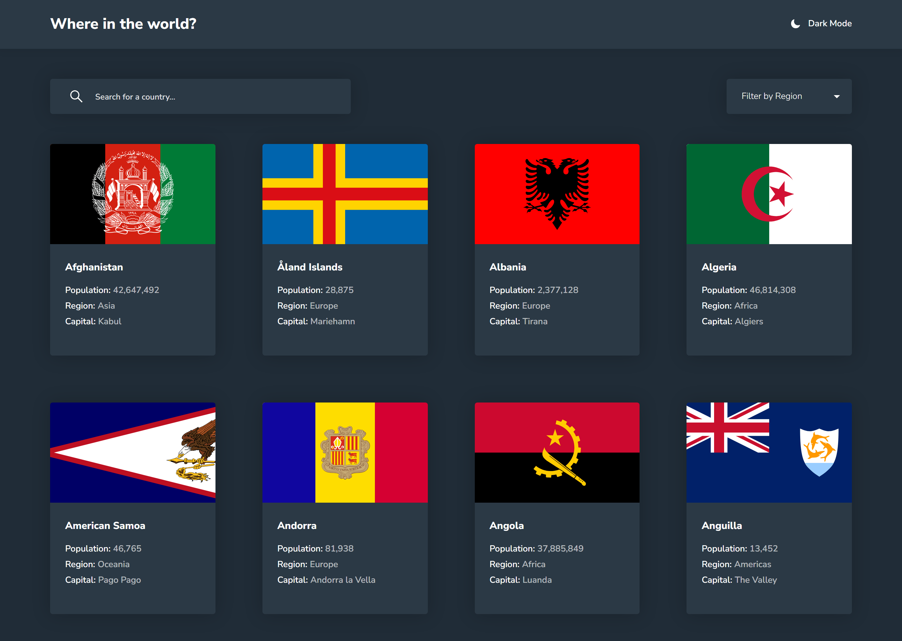
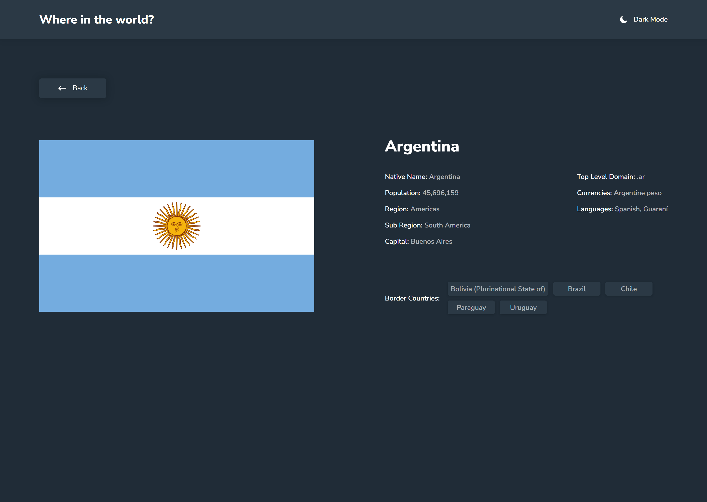

# Frontend Mentor - REST Countries API with color theme switcher solution

This is a solution to the [REST Countries API with color theme switcher challenge on Frontend Mentor](https://www.frontendmentor.io/challenges/rest-countries-api-with-color-theme-switcher-5cacc469fec04111f7b848ca).

## Table of contents

- [Overview](#overview)
  - [The challenge](#the-challenge)
  - [Project Screenshots](#project-screenshots)
  - [Links](#links)
- [My process](#my-process)
  - [Built with](#built-with)
  - [What I learned](#what-i-learned)
  - [Useful resources](#useful-resources)
- [Author](#author)

## Overview

### The challenge

Users should be able to:

- See all countries from the data on the homepage
- Search for a country using an `input` field
- Filter countries by region
- Click on a country to see more detailed information on a separate page
- Click through to the border countries on the detail page
- Toggle the color scheme between light and dark mode _(optional)_

### Project Screenshots

|                                   Home Page                                   |                                    Detail Page                                     |
| :---------------------------------------------------------------------------: | :--------------------------------------------------------------------------------: |
|  |  |

### Links

- Solution URL: [Add solution URL here](https://your-solution-url.com)
- Live Site URL: [Add live site URL here](https://your-live-site-url.com)

## My process

### Built with

- Semantic HTML5 markup
- CSS custom properties
- Flexbox
- CSS Grid
- Mobile-first workflow
- [React](https://reactjs.org/) - JS Library
- [Vite](https://vitejs.dev/) - Next Generation Frontend Tooling
- [Material UI (MUI)](https://mui.com/) - React UI framework for components & styling
- [React Router](https://reactrouter.com/) - Declarative routing for React
- [SVGR](https://react-svgr.com/) - SVG to React component transformer

### What I learned

Through building this project, I strengthened my understanding of client-side dynamic routing, handling dynamic parameters with **React Router**, efficient state management, and creating a responsive layout with custom themes using **Material UI**.

### Useful resources

- [Material UI Documentation](https://mui.com/material-ui/getting-started/) - Great resource for understanding MUI ThemeProvider and components.
- [React Router Docs](https://reactrouter.com/) - Essential guide for navigation and route parameters

## Author

- Website - [Add your name here](https://www.your-site.com)
- Frontend Mentor - [@yourusername](https://www.frontendmentor.io/profile/yourusername)
- Twitter - [@yourusername](https://www.twitter.com/yourusername)
